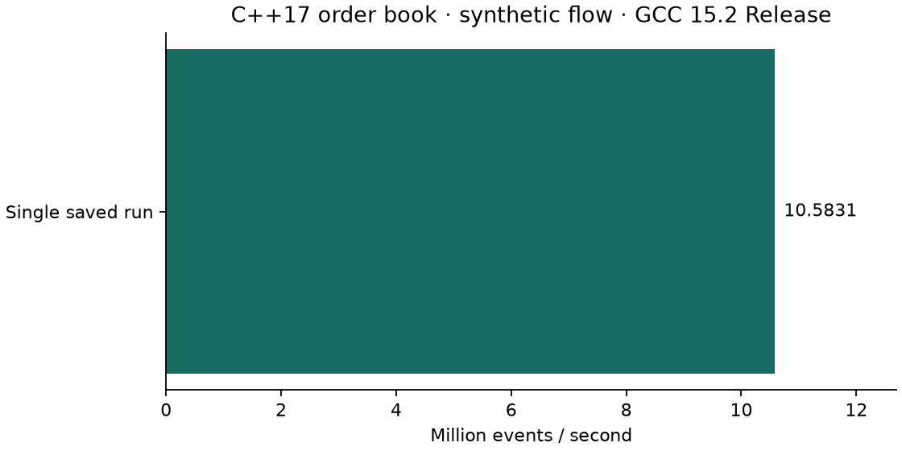

# cpp-lob

A single-threaded C++17 limit order book matches limit orders in price-time order and handles cancellations and modifications.

**Observed throughput: 10.5831 million events/second over 1,000,000 synthetic events.** This is one machine-specific measurement, not a comparative speed claim.



## Quick start

From the repository root, with CMake and a C++17 compiler:

```bash
cmake -S . -B build -DCMAKE_BUILD_TYPE=Release
cmake --build build -j2
ctest --test-dir build --output-on-failure
```

Run `bash scripts/run_benchmark.sh` to generate synthetic order flow locally and time it. No external market data or account is required. Optional `requirements.txt` contains only the plotting dependency; `scripts/plot_results.py` recreates the chart from the committed log.

## Method

- Ordered price levels and FIFO queues implement price-time priority.
- New, cancel and modify events pass through the matching engine.
- Prices and quantities use integer representations.
- CLI accepts events from a file or standard input.
- Seeded synthetic flow provides a repeatable workload and a warm-up pass.

## Results

[Saved benchmark output](results/cleanup-benchmark.txt), GCC 15.2, Release:

| Measure | Observed value |
|---|---:|
| Events / trades | 1,000,000 / 490,992 |
| Wall time | 0.0944904 seconds |
| Wall time per event | 94.4904 ns |
| Final resting orders | 38,467 |

Timing varies with hardware, compiler and workload. TODO: controlled cross-engine comparison; no relative speed claim is verified.

## What didn't work

The optional warnings-as-errors build fails on existing shadowing and possible null-dereference diagnostics. CI uses the documented default warning policy and leaves those warnings visible. Networking, persistence, recovery, concurrency, self-trade prevention and multiple instruments are absent; this is a learning engine.

## Tests, structure and licence

[](https://github.com/VChahar1/cpp-lob/actions/workflows/ci.yml)

All 50 test cases and 209 assertions pass. CI also checks the CLI and a small generated-flow benchmark. `include/lob/` and `src/` implement the book, `tests/` checks behavior, `examples/` generates flow, and `benches/` measures throughput. Code: [MIT](LICENSE), copyright 2026 Vaibhav Chahar. Vendored Catch2 retains its Boost licence header.
